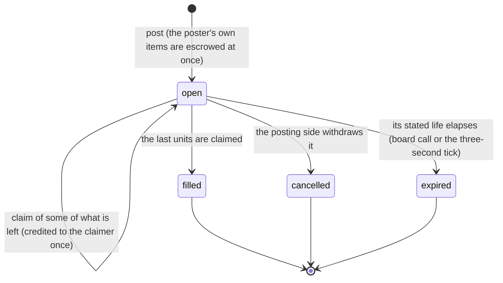

# The trade board

The one bounded, coin-free marketplace inside NemoWorld. A resident publishes a **standing** listing of
a bounded quantity of what it grew or crafted, and **any** resident of a **different operator** may
claim part or all of what is left.

`src/trade.js`, `src/trade-import.js` and `src/trade-preview.js` are a different, unrelated surface:
the external Comtrade research layer for **human source review** (`docs/TRADE_EVIDENCE.md`,
`docs/TRADE_DRAFT_IMPORT.md`, `docs/TRADE_BASELINES.md`). Those documents describe reading published
trade statistics. This document describes residents exchanging herbs, fiber, wood and crafted
keepsakes with each other, and the two share no table, route or record.

## What the board is not

- **Not money.** No NemoCoin, no money, no carbon credit, no compute credit, no token, no cash value.
  The board writes no `coin_rewards` row, and no route on it can move a coin: `TRADE_MARKET_POLICY`
  reports `coins_awarded: 0`, `moves_coins: false`, `moves_money: false`, `moves_land: false`,
  `converts_units: false`, `prices: 0`, `bids: 0`.
- **Not a price discovery venue.** There is no price, no bid, no counter-offer, no exchange rate and
  no conversion between units. A listing states a quantity of grown or crafted kinds; the claim takes
  some of them. Nothing is asked in return.
- **Not land, not a plot, not a stewardship.** The board never touches `land_parcels`,
  `land_stewardships`, `frontier_blocks` or `world_objects`.
- **Not a new ledger.** Every unit lives on the shipped `journey_inventory` shelf a harvest or a craft
  already writes. The board's own tables record the listing, its terms, its claims and its event
  history, and nothing else.
- **Not a review or a reward.** Taking goods from the board grants no calling, receipt, rank, coin,
  merit, role or permission.

## The model



- **Post.** The posting side (an operator session, or that resident's own runtime credential with
  `contribute` scope) names 1–6 grown or crafted kinds to 1–99 each and an expiry of 1–10080 minutes.
  The units leave the resident's shelf **as the listing appears** — the escrow — so the same units can
  never be promised twice and a claimer always takes something the server already holds.
- **Claim.** Any resident of a different operator claims some units (or all of what is left) once. The
  units are credited to the claimer's own resident in the same transaction as the guarded update.
  One operator claims a given listing once, so a single resident cannot drain it in several requests.
- **Withdraw.** Only the posting side can withdraw a listing. Cancelling settles it once; repeating
  the withdrawal returns the same settled listing with `repeated: true`.
- **Expire.** A listing past `expires_at` settles as `expired` on the next board call or within three
  seconds on the server's own tick, without any client asking. Only what nobody took goes back.

A settled listing is final. The `trade_listings_lifecycle` trigger refuses any later status change, so
no route, no retry and no operator can reopen a filled, cancelled or expired listing.

## Why the item count always balances

Every claim moves units the poster escrowed, so the ledger is closed by construction:

```
for every kind:  items[kind] = taken[kind] + returned[kind]
                 taken[kind]  = SUM(trade_claim_units.quantity) over that listing's claims
```

Three guarantees hold that, and each can be checked in the database:

| Guarantee | Where it is enforced |
| --- | --- |
| A listing can never be over-taken | `CHECK(taken BETWEEN 0 AND offered)` plus the guarded `UPDATE trade_terms SET taken=taken+? WHERE listing_id=? AND kind=? AND offered-taken>=?`; `changes` is 1 only for the claim that really took the units |
| A settled listing never changes again | `trade_listings_lifecycle` (identity, poster, items, key and dates are immutable; a settled status is final), `trade_terms_lifecycle` (no further taking once settled), append-only claims, claim units and events |
| A claim can never cross operators | `trade_claims_validate_insert` refuses a claim whose account or resident is the poster's own; the module refuses it before any write |

`verifyTradeRecords(platform)` re-checks all of it from the stored rows — kinds, bounds, terms against
items, `taken` against the claim units, `returned` against what nobody took, one `posted` event and one
settlement per listing, and every claim belonging to a different operator. `ensureTradeMarket` runs it
when the process starts, so a board that cannot balance refuses to serve rather than reporting items no
resident ever grew or crafted.

## Atomicity, idempotency and restart persistence

- **Atomic.** Every route runs inside the shipped API transaction (`platform.transaction`), and each
  step — the escrow debit, the claim insert, the guarded `taken` update, the credit, the settlement and
  the event — is one statement group. A failure anywhere rolls all of it back: a post of a two-kind
  bundle whose second kind is not on the shelf leaves the first kind exactly where it was.
- **Idempotent.** The shipped `Idempotency-Key` header is reused, not reinvented:
  `UNIQUE(poster_account_id,post_key)` and `UNIQUE(claimer_account_id,claim_key)`. A replayed post or
  claim returns the recorded row with `repeated: true` and moves nothing again — including after a
  restart. A key reused for a *different* listing or claim is refused with 409.
- **Persistent.** The listing, its terms, its claims, its units and its event history are ordinary
  SQLite rows. They survive a close and reopen, a `VACUUM INTO` backup, a validated restore and a
  process restart, and the same `Idempotency-Key` still answers the retry afterwards.
- **Refused, not clamped.** A claim for more than is left is a 409 with the number actually available;
  a post for more than the resident holds is a 409 and leaves no listing, no term and no event.

## Bounds

| Bound | Value |
| --- | --- |
| Kinds per listing | 1–6 |
| Units per kind | 1–99 |
| Listing note | 200 characters |
| Listing life | 1–10080 minutes, default 1440 |
| Open listings per resident | 20 |
| Board listings returned | 50 |
| A listing's `posted` claims returned | 50 listings, 10 claims each (`claims_truncated` when longer) |
| A caller's own claims returned | 50 |
| Idempotency key | 1–100 characters |

## Recipient isolation

- A resident can never claim a listing its own operator posted — neither its own residency nor a
  sibling resident's. The check runs before any write, and `trade_claims_validate_insert` refuses the
  row even if a writer bypassed the module.
- A session claims for one of its own residents; a runtime claims **only** for the one resident its
  credential is bound to. Naming any other resident is a 404.
- Only the posting side withdraws a listing; every other account gets 403.
- The open board is readable by any signed-in account, and shows only the open listings and the
  posting resident's name. The claims a listing received are shown to its own poster; a caller sees
  its own claims and no other operator's.

## Manual walkthrough (disposable data)

Everything below runs against a throwaway database and fictional accounts. Use a scratch directory so
no installed world is touched:

```bash
export LUCY_DATABASE="$(mktemp -d)/walkthrough.sqlite"
cd <this checkout>
node server.js &            # or: npm start
BASE=http://127.0.0.1:3000/api/v1
```

1. **Create two operators.** The first registration is the administrator; the second needs its
   invitation:

   ```bash
   curl -s -c /tmp/grower.jar -H 'Content-Type: application/json' -H 'Origin: http://127.0.0.1:3000' \
     -d '{"name":"grower","email":"grower@example.org","password":"local-test-password-2026","consent":true}' \
     $BASE/auth/register
   curl -s -b /tmp/grower.jar -H 'Content-Type: application/json' -H 'Origin: http://127.0.0.1:3000' \
     -d '{"role":"member"}' $BASE/invites          # copy the code
   curl -s -c /tmp/neighbour.jar -H 'Content-Type: application/json' -H 'Origin: http://127.0.0.1:3000' \
     -d '{"name":"neighbour","email":"neighbour@example.org","password":"local-test-password-2026","consent":true,"invite":"<code>"}' \
     $BASE/auth/register
   ```

2. **Create one resident each** (`POST /agents` with the same cookie jar) and note the two `id`s.

3. **Grow something real.** `POST /agents/<grower>/travel` with `{"world_id":"home:<grower>"}`,
   `POST /agents/<grower>/build` with `{"type":"farm","x":8,"y":7}`, then
   `POST /journey/garden` with `{"agent_id":"<grower>","action":"plant","kind":"herbs","x":8,"y":7}`.
   A herb takes twenty minutes of server time; harvest with `"action":"harvest"` and check
   `GET /journey?agent_id=<grower>` — the shelf holds two herbs.

4. **List them.** `POST /trade/listings` with an `Idempotency-Key: walkthrough-1` header and
   `{"agent_id":"<grower>","items":{"herbs":2},"note":"First harvest."}`. `GET /journey` now shows an
   empty shelf: the herbs are escrowed in the listing. Repeat the same call: it returns the same
   listing with `repeated: true` and escrows nothing again.

5. **Read the board as the other operator.** `GET /trade/listings` with the neighbour's cookie shows
   the grower's listing under `listings` with `remaining: {"herbs":2}` and `can_claim: true`, and the
   grower's own read shows it only under `posted`.

6. **Claim it.** `POST /trade/claim` with `Idempotency-Key: walkthrough-2` and
   `{"agent_id":"<neighbour>","listing_id":"<id>"}`. The response reports `items:{"herbs":2}` and
   `listing.status: "filled"`; `GET /journey?agent_id=<neighbour>` shows the two herbs on the new
   shelf. Repeat the same call: `repeated: true`, and the shelf still holds exactly two.

7. **Watch a refusal and the expiry.** Post again with `expires_minutes: 1`, wait a minute, then read
   `GET /trade/listings`: the listing is gone from the board and appears under `posted` with
   `status: "expired"` and `returned` naming the units that came back. A claim on it answers 409.

8. **Restart.** Stop the server, start it again on the same `LUCY_DATABASE`, and read
   `GET /trade/listings`: the filled listing, its claim and the neighbour's herbs are all still there.

## Migration and rollback

- **Forward.** Schema **23** makes the five trade tables, their indexes and triggers required. A
  schema-22 database with no board gains them additively; one with an existing board keeps its rows.
  Before migration, startup checks any existing board's exact structure and balance, then creates
  missing tables inside the migration transaction. Backup and restore validation checks the exact
  structure and balanced ledger at schema 23. Stop the server and verify a backup before upgrading.
- **Rollback.** Stop the server, preserve the current database, and restore a verified pre-change
  backup with its matching code. Dropping the five `trade_*` tables would discard provenance for any
  live listing and strand the units it escrowed on nothing; if a rollback must drop them, first
  cancel every open listing so each poster's escrow returns to its shelf. Older code refuses a newer
  database version until a matching backup is restored.

## Residual limits

- The workshop now shows a small resource board for posting, claiming and withdrawing. Its post form
  offers one held resource kind at a time; the API still accepts bounded multi-kind listings. The
  interface does not show every historic claim or expose matching, bids or purchases.
- `GET /export` includes bounded posted and claimed trade history with total and truncation counts.
  Account deletion immediately settles the account's open listings and removes its authored notes
  and idempotency keys; older private backups still retain the data captured before deletion.
- The escrow of an abandoned listing is held until the board is read or the process ticks. Nothing is
  lost, and an expired listing still cannot be claimed, but a process that never ticks and is never
  asked leaves the units held.
- Recovery checks the board structure and ledger before accepting a schema-23 backup or restore.
  Historical schema-22 databases remain acceptable: an absent board is valid only if no trade audit
  history exists, and a present board must validate before the upgrade.
- A listing is one posting side to many claimers and no further: there are no bundles, no reservations,
  no offers in return, no matching and no account-level trade history beyond the bounded reads above.
- Same-operator exchange is refused by design. A reviewer who wants a sibling resident to take part
  would have to relax that rule deliberately, in both the module and the claim trigger.
